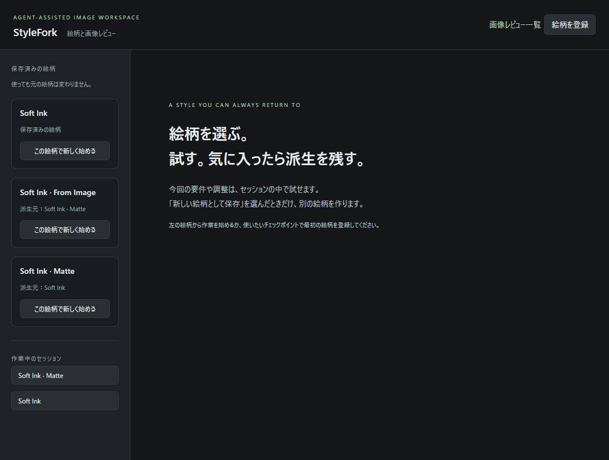

# StyleFork

**元の絵柄に、いつでも戻れる画像制作。**

AIエージェントと画像を作り、比較して評価し、気に入った雰囲気を新しい「絵柄」として保存するためのローカルキットです。

[English](README.md) · [使い方](docs/TUTORIAL.md) · [ダウンロード](https://github.com/kamahir0/stylefork/releases)



## 基本の考え方

- **保存済みの絵柄**は、生成や評価で変化しません。
- **今回の要件・調整**は、そのセッションの中に置きます。別のセッションへ引き継ぎません。
- **「新しい絵柄として保存」**を選んだときだけ、元の絵柄を残して派生を作ります。
- 「良い画像だった」「お気に入り」と、「絵柄として保存」は独立した判断です。

例えば、元の絵柄に色っぽい雰囲気を加えて試しても、別セッションで元の絵柄を選べば元の設定から始まります。今回だけの飲料抑制は要件側に置き、保存する絵柄へ混ぜません。

## 人間とエージェントの分担

あなたは画像を見て評価し、保存したい絵柄を決めます。エージェントは生成設定の整理、ComfyUIの操作、ファイル管理、比較用レビューの準備を担当します。

画像には短い番号が付きます。原寸・拡大・左右比較、Fキーの全画面表示、← → キー、左下の自動で消えるサムネイル列で確認できます。評価とメモを確定したら、画面の依頼文をチャットへ貼り、エージェントに読み取ってもらいます。

## はじめる

制作プロジェクトのルートは **AGENTS.md・.agents・output・styles・.stylefork** に揃えます。画像はoutput、絵柄はstylesへ、ワークフローや評価などは隠し管理フォルダへ保存します。キット本体とComfyUIはプロジェクト外で共有できます。[ディレクトリ構造](docs/PROJECT_LAYOUT.md)を参照してください。

Python 3.10以降とブラウザーがあれば、UIを起動できます。npmやPythonの追加ランタイムパッケージは不要です。

初めて使うPCでは、次の順に準備します。

1. Python 3.10以降をインストールする。
2. [Releases](https://github.com/kamahir0/stylefork/releases) のZIPをダウンロードし、共有ツールの場所（例：`D:\Tools\StyleFork`）へ展開する。Gitを使う場合は `git clone https://github.com/kamahir0/stylefork.git D:\Tools\StyleFork` でも取得できる。専用インストーラーはない。
3. 画像生成を使うなら、別の共有フォルダへComfyUIと使用するモデル・必要なカスタムノードを用意し、起動する。キットには含まれない。
4. 制作プロジェクトを別の場所へ初期化する。

```powershell
python D:\Tools\StyleFork\run.py --workspace D:\Projects\Illustration init --comfy-home D:\Tools\ComfyUI --comfy-url http://127.0.0.1:8188
```

5. **制作プロジェクト**の `D:\Projects\Illustration` をCodexなどのエージェントで開き、「このプロジェクトのAGENTS.mdとStyleForkスキルを読んで制作を始めたい」と依頼する。
6. プロジェクト内から接続確認とUI起動を行う。

```powershell
python .agents/stylefork.py doctor
python .agents/stylefork.py serve
```

`http://127.0.0.1:8767` を開き、最初の絵柄を登録する。既存の絵柄を持ち込む場合は、親の絵柄も含む必要なJSONと、対応するモデル・LoRAを用意する。Google Driveは任意で設定する。

ランチャーを使う場合は、Windowsでは `D:\Tools\StyleFork\start.bat "D:\Projects\Illustration"`、macOS/Linuxでは `sh /path/to/StyleFork/start.sh /path/to/project`。保存先は必須で、キット内に暗黙のworkspaceは作らない。

Python環境へwheelをインストールする方法も使える。インストール後は `stylefork --workspace <project> init` で同じプロジェクト構成と制作スキルを作成できる。キット側のAGENTS.mdは開発者用で、制作時に読む必要はない。

画像生成には、別途起動したComfyUIと自分で用意したモデルが必要です。現時点の内蔵生成は標準的なSD/SDXL系ワークフロー向けです。画像確認だけならComfyUIは不要です。アプリだけでエージェントが自動起動するわけではなく、依頼文をチャットに送って作業を進めます。

生成画像は **コンセプト／スレッド → ターン** のフォルダに保存します。一つのターンに複数バッチがあっても保存先は共通です。Google Driveを使う場合も同じ画像フォルダ階層にします。

モデル・個人の画像・認証情報・研究履歴は配布物に含みません。既存プロジェクトの移行方法や設定は [docs](docs/TUTORIAL.md) を参照してください。

このキットは初期リリースです。コードは[MITライセンス](LICENSE)です。利用するモデルや外部サービスの条件は、それぞれに従ってください。
