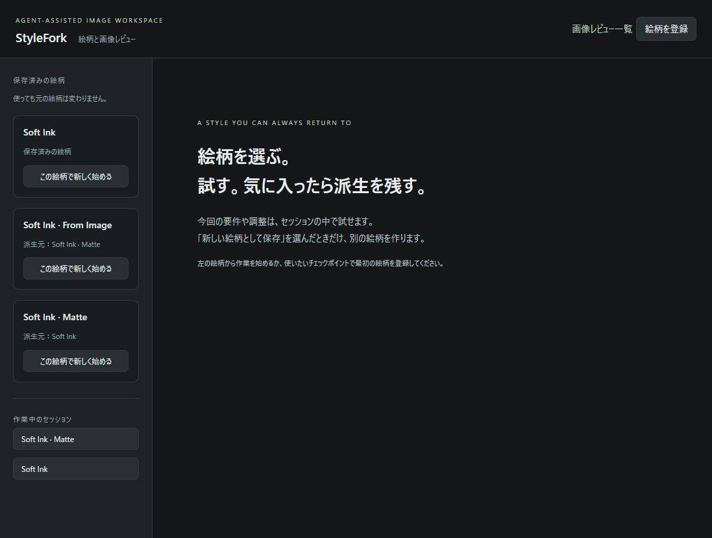

# StyleFork

**Try a new direction. Keep the style you started with.**

StyleFork is a local workspace for creating images with an AI coding agent, comparing the results, and saving an atmosphere as a new, reusable style.

[日本語](README.ja.md) · [Tutorial](docs/TUTORIAL.md) · [Architecture](docs/ARCHITECTURE.md) · [Releases](https://github.com/kamahir0/stylefork/releases)



## How it works

1. **Choose a saved style.** Start a separate working session from it.
2. **Add this session's requirements.** Explore subjects, lighting, expressions and other changes with your agent.
3. **Review the images.** Current candidates and past references share short numbers in one viewer. Enlarge them, compare side by side, or use fullscreen with arrow keys and an automatically hiding filmstrip.
4. **Save a fork when you decide.** A new style retains its parent and recipe. The original style and other sessions stay unchanged.

Generation, praise and review ratings do not update saved styles. Scene requirements and one-off exclusions are recorded separately from the reusable recipe.

The human judges the appearance and decides when to save a new style. The agent operates the tools, prepares generation settings, organizes outputs and reads submitted feedback. The app does not run an AI agent or send chat messages by itself.

## Start locally

You need **Python 3.10+** and a desktop browser. The UI has no Python runtime dependencies, npm installation, cloud account or API key requirement.

Download and extract a [release ZIP](https://github.com/kamahir0/stylefork/releases), then open the folder in your coding agent:

> Read AGENTS.md and help me start StyleFork. Keep my saved styles unchanged unless I explicitly ask to save a new fork.

On Windows, run `start.bat`. On macOS/Linux, run `sh start.sh`. The app is at **http://127.0.0.1:8767** and the launchers use a `workspace/` data directory.

Or choose your own data folder:

```sh
python -m stylekit --workspace /path/to/my-art init
python -m stylekit --workspace /path/to/my-art serve
```

Register a style in the UI, then choose **この絵柄で新しく始める**. The current UI is in Japanese; the CLI and these docs also support English-speaking agents. The [tutorial](docs/TUTORIAL.md) explains each step.

## Image generation

The included generator connects to an existing **ComfyUI** server. Supply your own checkpoints and LoRAs. The built-in recipe assembler currently targets standard **SD/SDXL-style checkpoint + CLIP + KSampler workflows**, with optional model upscale and detector/detailer nodes. Required custom nodes must already be installed in ComfyUI.

Arbitrary architectures and arbitrary uploaded workflow graphs are not universally supported. Your agent can prepare generation outside the built-in adapter and register images with their workflow, but it must record the actual settings. The viewer works without ComfyUI.

Google Drive is optional. `drive-plan` reports the exact image-only folder layout for a connected agent to synchronize. The kit contains no Drive credentials or personal folder IDs and does not require a particular Drive CLI.

## Data stays separate

```text
my-art/
  AGENTS.md       # project-bound instructions
  .agents/        # launcher and project skill
  output/         # images only, grouped by concept/turn
  styles/         # immutable reusable style records
  .stylefork/     # hidden settings, workflows, sessions, reviews and history
```

The shared kit and ComfyUI can live outside every creation project. Each project stores `kit_home`, optional `comfy_home`, and `comfy_url` in its hidden configuration. To launch the kit from a project, use `python .agents/stylefork.py serve`. Workflows stay under `.stylefork/workflows/` rather than beside the visible images.

Use a single turn folder for all batches generated in one exchange. Drive image directories mirror the relative hierarchy below `output/`; JSON and research documents remain local. Existing research workspaces with `.research/state.json` can be imported and reviewed without publishing their contents. See [migration](docs/MIGRATION.md).

## Development

```sh
python -m unittest discover -s tests
python scripts/release.py
```

The release script uses an explicit source allowlist and excludes user workspaces, images, models, credentials and generated outputs. See [releasing](docs/RELEASING.md) before publishing.

This is an initial release. Recipe provenance improves reproducibility but does not guarantee identical pixels across hardware or changed model files. Exact existing images are preserved as snapshots.

Inspired by the human/agent collaboration approach of [Charakuru](https://github.com/nanocle/Charakuru). This is an independent project; no Charakuru code or assets are included.

## License

[MIT](LICENSE). Models, LoRAs, generated images and external services have their own applicable terms and are not included in the kit.
